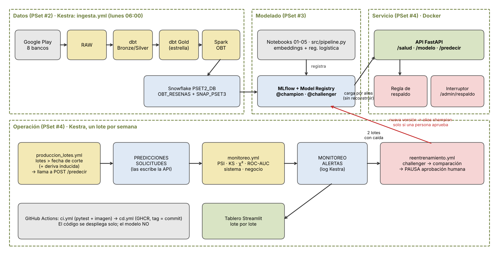

# Proyecto final · Priorización de reseñas negativas de apps bancarias de Ecuador

**Autora:** Nataly Cuichán · Fundamentos de Ciencia de Datos: End to End (PSets #1 a #4)

Las reseñas de Google Play de 8 entidades financieras se ingieren cada semana. Un modelo
(embeddings multilingües + regresión logística) estima la probabilidad de que cada reseña sea una
queja (≤ 2 estrellas). Las que superan el umbral de costo pasan a la **cola prioritaria** del
equipo de atención digital. El modelo se sirve con una API, se monitorea lote por lote y se
reentrena con aprobación humana.



```
fuente → RAW → Bronze → Silver → Gold → OBT → EDA y modelo → registro → API → simulación → monitoreo → reentrenamiento
```

## Estructura

```
proyecto_final/
├── docker-compose.yml        Kestra, MLflow, API, tablero, Jupyter (+ dbt y Spark a demanda)
├── .env.example              plantilla de variables (el .env real NO se sube)
├── requirements.txt          dependencias del modelo (las mismas en Jupyter, API y CI)
├── .github/workflows/        ci.yml (pruebas + imagen) y cd.yml (publica en GHCR)
├── kestra/                   ingesta · produccion_lotes · monitoreo · reentrenamiento
├── dbt/  spark/              capas Bronze/Silver/Gold y OBT (PSet #2)
├── src/                      datos, pipeline (PSet #3), simulación, reentrenamiento, registro de modelos
├── notebooks/                01-05 (+03b, 03c LLM local, 05b) del PSet #3; 06 simulación; 07 monitoreo, ética y negocio
├── api/                      FastAPI: main.py, esquemas.py, servicio.py, registro.py, Dockerfile
├── monitoreo/                deriva.py, alertas.py, referencia.py, ejecutar.py
├── tablero/                  Streamlit
├── tests/                    contrato, modelo, comportamiento, respaldo, monitoreo (+ fixtures/)
├── scripts/                  exportar_fixture.py, exportar_evidencia.py
└── docs/                     diagramas, cambios.md, CSV de evidencia, memos e historial
```

## Requisitos

- Docker Desktop con Docker Compose v2 (Windows: con el backend WSL 2).
- La cuenta de Snowflake, el usuario `PSET2_SVC` y la llave `secrets/rsa_key.p8` del PSet #2.
- Los volúmenes de MLflow del PSet #3 (`docker volume ls` debe mostrar `pset_3_mlflow-db-data` y `pset_3_mlflow-artifacts`).
- No hace falta instalar Python: todo corre en contenedores.

Los comandos son de PowerShell y se ejecutan dentro de `proyecto_final/`.

---

## 1. Configuración

### 1.1 Llave de Snowflake

Si vienes del PSet #2, copia la llave (si no, sigue el paso 1 del README del PSet #2 para crearla):

```powershell
mkdir secrets
Copy-Item ..\pset_2\secrets\rsa_key.p8 secrets\
```

### 1.2 Variables de entorno

```powershell
Copy-Item .env.example .env
notepad .env
```

| Variable | Valor |
|---|---|
| `SNOWFLAKE_ACCOUNT` y `ENV_SNOWFLAKE_ACCOUNT` | `<organizacion>-<cuenta>` (las dos iguales) |
| `SECRET_SNOWFLAKE_PRIVATE_KEY` | `[Convert]::ToBase64String([IO.File]::ReadAllBytes("$PWD\secrets\rsa_key.p8"))` |
| `KESTRA_DB_PASSWORD`, `JUPYTER_TOKEN` | los que elijas |
| `MLFLOW_DB_PASSWORD` | **la misma del PSet #3** (la base de MLflow ya existe) |
| `ADMIN_TOKEN` | uno que elijas (protege `/admin/*` de la API) |
| `SECRET_ADMIN_TOKEN` | el mismo token en base64: `[Convert]::ToBase64String([Text.Encoding]::UTF8.GetBytes("<tu_token>"))` |
| `API_TAG` | `latest` o el hash de un commit publicado por `cd.yml` |

> `.env` y `secrets/` están en `.gitignore`. No subas contraseñas, tokens ni llaves.

### 1.3 Objetos de Snowflake

En una hoja de Snowflake, ejecuta `docs/setup_produccion.sql`. Crea la **instantánea** `OBT.OBT_RESENAS_SNAP_PSET3` (la OBT con la que se entrenó el champion; debe tener 21 698 filas) y el esquema `PRODUCCION`.
**Hazlo antes de volver a ejecutar la ingesta**, para que la instantánea sea la del PSet #3.

### 1.4 Fijar versiones (una vez)

Un modelo de scikit-learn guardado con pickle solo es confiable con la misma versión de la librería.
Después del paso 2, ejecuta `docker compose exec jupyter python scripts/exportar_fixture.py`. Al final, el script imprime las versiones con las que se entrenó el champion: fíjalas en `requirements.txt` (por ejemplo `scikit-learn==1.x.y`) y reconstruye con `docker compose build`.

## 2. Levantar la infraestructura

```powershell
docker compose --profile tools build dbt spark   # imágenes que Kestra ejecuta
docker compose up -d --build                     # Kestra, MLflow, API, tablero, Jupyter
docker compose ps
```

| Servicio | URL |
|---|---|
| Kestra | http://localhost:8080 |
| MLflow | http://localhost:5000 |
| API (documentación interactiva) | http://localhost:8000/docs |
| Tablero | http://localhost:8501 |
| JupyterLab | http://localhost:8888 (token: `JUPYTER_TOKEN`) |

La primera construcción tarda (torch CPU y el modelo de embeddings, ~470 MB, quedan dentro de las imágenes).

Los flujos de `kestra/` (`ingesta`, `monitoreo`, `reentrenamiento` y `produccion_lotes`, namespace `proyecto_final`) **se cargan solos** al arrancar Kestra y se recargan cada vez que se guarda uno de esos archivos: no hay que copiarlos en la interfaz. Compruébalo en **Flows**.

> Kestra 2.0: los flujos usan `Loop` (no `ForEach`), `BOOL` en las entradas y no usan `pluginDefaults`.

## 3. Datos: fuente → RAW → Bronze → Silver → Gold → OBT

En Kestra, ejecuta el flujo **`ingesta`** (`max_por_banco = 3000`). Hace la carga incremental desde Google Play a `RAW`, luego `dbt build` (Bronze, Silver, Gold y las 43 pruebas) y Spark (la OBT, con la validación de joins). El trigger `ejecucion_semanal` lo repite los lunes a las 06:00; el backfill se hace desde la pestaña **Triggers**.

Los pasos también se pueden correr a mano: `docker compose run --rm dbt build` y `docker compose run --rm spark`.

## 4. EDA y modelo (PSet #3)

En JupyterLab, abre `notebooks/` y ejecuta **Restart & Run All** en orden: `01_eda` → `02_features` → `03_baseline_candidatos` → `03b_embeddings` → `03c_llm_local` → `04_tuning` → `05_seleccion` → `05b_verificacion_champion`.

El `03c` compara un LLM local por *prompting* (Qwen2.5-1.5B en Ollama) con el champion y la regla. Antes de ejecutarlo:

```powershell
docker compose --profile llm up -d ollama
docker compose exec ollama ollama pull qwen2.5:1.5b
```
Todos leen la instantánea de la OBT, así que reproducen el PSet #3 aunque la ingesta haya traído reseñas nuevas. El `05` reutiliza las corridas finales si ya existen (no borra el registro).

## 5. Registro del modelo

```powershell
docker compose exec jupyter python -m src.registro_modelos estado
```

Muestra las versiones de `resenas-bancos-ec-modelo` y sus alias (`champion`, `challenger`, `champion_anterior`).

## 6. API

```powershell
curl.exe http://localhost:8000/salud
curl.exe http://localhost:8000/modelo
curl.exe -X POST http://localhost:8000/predecir -H "Content-Type: application/json" `
  -d '{\"comentario_limpio\": \"no me deja ingresar desde la actualizacion, pesimo\", \"banco\": \"Banco Pichincha\", \"es_solo_simbolos\": 0, \"version_app_desconocida\": 0}'
```

Respuesta (ejemplo):

```json
{"id_prediccion": "…", "probabilidad": 0.97, "decision": "priorizar",
 "accion": "Enviar a la cola prioritaria del equipo de atención digital: revisar y responder en menos de 24 h.",
 "umbral": 0.22, "modelo": "resenas-bancos-ec-modelo", "version_modelo": "1", "alias": "champion",
 "run_id": "…", "respaldo": false, "motivo_respaldo": null, "latencia_ms": 12.4}
```

Una entrada inválida (por ejemplo `"banco": "Banco X"`) devuelve **422** con el campo que falló. Cada predicción queda en `PRODUCCION.PREDICCIONES` (id, timestamp, entradas, salida, versión, run_id, latencia) y cada solicitud, incluidas las rechazadas, en `PRODUCCION.SOLICITUDES`.

**Rollback** (sin reconstruir la imagen): `docker compose exec jupyter python -m src.registro_modelos rollback` mueve `champion` a `champion_anterior` (o `--a-version N`). La API revisa el alias cada 30 s; `GET /modelo` muestra la versión nueva.

**Interruptor de respaldo:** la regla de negocio decide en lugar del modelo.

```powershell
$h = @{ "X-Token-Admin" = "<tu ADMIN_TOKEN>" }
Invoke-RestMethod -Method Post http://localhost:8000/admin/respaldo -Headers $h -ContentType "application/json" -Body '{"activo": true, "motivo": "demo"}'
# volver al modelo: {"activo": false}
```

También se puede arrancar en respaldo con `MODO_RESPALDO=true` en `.env` y `docker compose up -d api`.

## 7. Pruebas

```powershell
docker compose exec jupyter python scripts/exportar_fixture.py   # copia del champion + muestra fija en tests/fixtures/
docker compose exec -e EMB_CACHE= jupyter python -m pytest tests -v
```

| Archivo | Qué prueba |
|---|---|
| `test_contrato.py` | 200 con el esquema esperado; 422 con campo faltante, tipo incorrecto, categoría desconocida, fuera de rango o campo extra; registro de la predicción |
| `test_modelo.py` | La copia exportada reproduce la métrica registrada en MLflow sobre la muestra fija (tolerancias justificadas en el archivo) |
| `test_comportamiento.py` | Agregar una queja no baja la probabilidad; casos inequívocos; una queja clara se prioriza en cualquier banco |
| `test_respaldo.py` | Si el modelo no carga, responde la regla de negocio e indica `respaldo: true`; interruptor manual |
| `test_monitoreo.py` | PSI, pruebas estadísticas, umbrales, regla de disparo y regla de promoción |

Sube `tests/fixtures/` al repositorio: en GitHub Actions no hay MLflow. `ci.yml` instala dependencias, construye la imagen y ejecuta pytest en cada push y pull request. Cuando CI pasa en un push a `main`, `cd.yml` publica `ghcr.io/<usuario>/resenas-bancos-api:<hash del commit>`. La primera vez, en GitHub → *Packages*, cambia la visibilidad del paquete a pública (o haz `docker login ghcr.io`) para que `docker compose pull api` funcione.

## 8. Simulación, monitoreo y reentrenamiento

1. En Kestra, ejecuta **`produccion_lotes`** (`reiniciar = true`). Arma los lotes semanales posteriores a la fecha de corte, induce la deriva en los últimos 5 (ver `docs/deriva_inducida.md`) y calcula la referencia de monitoreo. Después, para cada lote: la API lo puntúa, y `monitoreo` calcula métricas, guarda `MONITOREO` y `ALERTAS` y avisa en el log.
2. Cuando 2 lotes seguidos muestran caída de desempeño, `monitoreo` lanza **`reentrenamiento`**: entrena el challenger, lo compara con el champion y **se pausa**. En Kestra, abre la ejecución pausada, revisa el log de `comparacion` y pulsa **Resume** con `aprobar = true` o `false` y el motivo. Si apruebas, el alias `champion` pasa a la versión nueva y la API la toma sin reconstruir la imagen.
3. Mira el tablero en http://localhost:8501.
4. Ejecuta `notebooks/06_simulacion_produccion.ipynb` y `07_analisis_monitoreo.ipynb` (Restart & Run All).
5. Exporta la evidencia:

```powershell
docker compose exec jupyter python scripts/exportar_evidencia.py
```

Genera `docs/predicciones.csv`, `monitoreo.csv`, `alertas.csv`, `corridas.csv` (todas las corridas de MLflow), `reentrenamientos.csv` (las de `fase = reentrenamiento`) y `reentrenamientos_decisiones.csv`.

## Trazabilidad de una predicción

`PREDICCIONES.id_prediccion` → `version_modelo` y `run_id` → en MLflow, los parámetros `tabla_origen`, `obt_snapshot`, `lotes_snapshot`, `hash_dataset` y `fecha_corte_snapshot` → `OBT_RESENAS_SNAP_PSET3` (o `PRODUCCION.LOTES_SNAP_*` en un reentrenamiento) → `GOLD.FCT_RESENA` y sus dimensiones (`spark/build_obt.py`). El notebook 06 muestra un ejemplo completo.

## Documentos

- `docs/PSet4_memo_Cuichan_Ortiz.pdf`: documento técnico (incluye el enlace al video de demostración).
- `docs/PSet4_presentacion_Cuichan_Ortiz.pdf`: presentación ejecutiva.
- `docs/cambios.md`: observaciones corregidas y decisiones actualizadas.
- `docs/historial/`: memos de los PSets #1 a #3.
