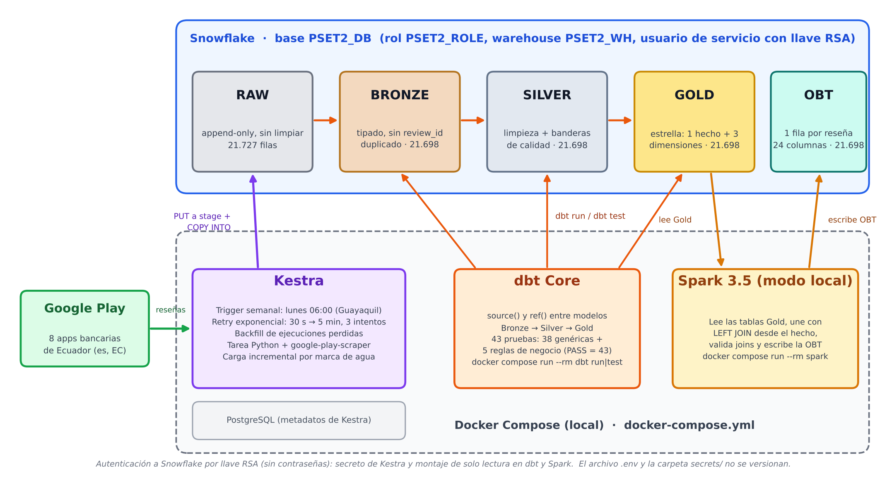
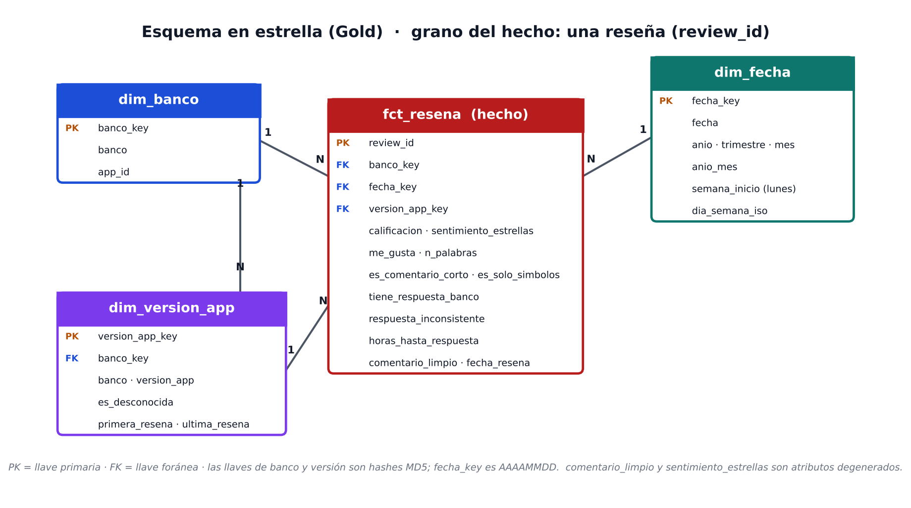

# PSet #2 · Pipeline de datos end-to-end

**Proyecto:** voz del cliente en las apps bancarias de Ecuador (reseñas públicas de Google Play de 8 entidades).
**Autora:** Nataly Cuichán · Fundamentos de Ciencia de Datos: End to End

```
Google Play → Kestra → RAW → dbt → BRONZE → dbt → SILVER → dbt → GOLD → Spark → OBT   (todo en Snowflake)
```



El documento técnico (`docs/PSet2_memo_Cuichan_Ortiz.pdf`) explica las decisiones; este README explica cómo reproducir el pipeline.

## Estructura

```
pset_2/
├── docker-compose.yml        # Kestra + PostgreSQL (metadatos), dbt Core y Spark
├── .env.example              # plantilla de variables (el .env real NO se sube)
├── README.md
├── kestra/                   # flujo de ingesta (trigger semanal, retry, backfill)
├── dbt/                      # Bronze, Silver, Gold (estrella), pruebas
├── spark/                    # construcción y validación de la OBT
└── docs/                     # diagramas, documento técnico, SQL de preparación y evidencias
```

## Requisitos

- Docker Desktop (con Docker Compose v2) y conexión a internet.
- Una cuenta de Snowflake (basta una de prueba) y acceso al rol `ACCOUNTADMIN` para el paso 1.
- No se necesita instalar Python, dbt ni Spark en tu computador: todo corre en contenedores.

## Paso a paso

Los comandos están en PowerShell (Windows); las variantes para Mac/Linux se indican donde cambian.

### 1. Llaves y usuario de servicio en Snowflake

El pipeline se conecta con un usuario de servicio (`PSET2_SVC`) por **llave RSA**, sin contraseñas.

```powershell
mkdir secrets
docker run --rm -v "${PWD}:/work" -w /work alpine/openssl genpkey -algorithm RSA -pkeyopt rsa_keygen_bits:2048 -out secrets/rsa_key.p8
docker run --rm -v "${PWD}:/work" -w /work alpine/openssl pkey -in secrets/rsa_key.p8 -pubout -out secrets/rsa_key.pub
```
(Mac/Linux: usa `"$(pwd)"` en lugar de `"${PWD}"`.)

Obtén la llave pública en una sola línea y pégala en `docs/setup_snowflake.sql` (donde dice `PEGA_AQUI_LA_LLAVE_PUBLICA`):

```powershell
(Get-Content secrets/rsa_key.pub | Select-Object -Skip 1 | Select-Object -SkipLast 1) -join ""
```
(Mac/Linux: `grep -v "PUBLIC KEY" secrets/rsa_key.pub | tr -d '\n'`.)

Ejecuta `docs/setup_snowflake.sql` en una hoja de Snowflake como `ACCOUNTADMIN`. Crea el rol `PSET2_ROLE`, el warehouse `PSET2_WH` (X-Small, se suspende a los 60 s), la base `PSET2_DB` con los esquemas `RAW`, `BRONZE`, `SILVER`, `GOLD` y `OBT`, y el usuario `PSET2_SVC`.

### 2. Variables de entorno

Copia `.env.example` como `.env` y completa:

- `SNOWFLAKE_ACCOUNT`: el identificador `<organizacion>-<cuenta>` (en Snowflake: `SELECT CURRENT_ORGANIZATION_NAME(), CURRENT_ACCOUNT_NAME();`).
- `KESTRA_DB_PASSWORD`: una contraseña local que elijas para la base PostgreSQL de Kestra (se usa solo dentro de Docker).
- `SECRET_SNOWFLAKE_PRIVATE_KEY`: la llave privada en base64.

```powershell
$key = [Convert]::ToBase64String([IO.File]::ReadAllBytes("$PWD\secrets\rsa_key.p8"))
"SNOWFLAKE_ACCOUNT=<organizacion>-<cuenta>`nKESTRA_DB_PASSWORD=<elige_una>`nSECRET_SNOWFLAKE_PRIVATE_KEY=$key" | Set-Content -Encoding ascii .env
```
(Mac/Linux: `base64 -w0 secrets/rsa_key.p8`.)

> `.env` y `secrets/` están en `.gitignore`. No subas contraseñas, tokens ni llaves.

### 3. Levantar Kestra

```powershell
docker compose up -d
```

Abre http://localhost:8080 (la primera vez puede pedirte crear una cuenta local).

### 4. Importar y ejecutar el flujo de ingesta

1. En Kestra: **Flows → Create**, pega el contenido de `kestra/ingesta_resenas_google_play.yml` y cambia `snowflake_account` (variable al inicio) por tu identificador. **Save**.
2. **Execute** con `max_por_banco = 3000`. Con la tabla vacía hace la **carga histórica** (unos 2 minutos).
3. Vuelve a ejecutar: ahora es **incremental** (descarga solo reseñas más nuevas que la última ya cargada de cada banco; unos 20 s).

**Trigger y frecuencia:** `ejecucion_semanal`, lunes 06:00 (America/Guayaquil).
**Retries y errores:** `extraer_resenas` reintenta con espera exponencial (30 s, tope 5 min, 3 intentos); el bloque `errors` registra el fallo.
**Backfill:** en el flujo, pestaña **Triggers** → *Backfill executions* sobre `ejecucion_semanal`, con el rango de semanas a recuperar. Es seguro repetirlo: la carga parte de la última reseña guardada, y Bronze elimina el solape.

### 5. dbt (Bronze → Silver → Gold)

```powershell
docker compose build dbt
docker compose run --rm dbt debug      # debe terminar con "All checks passed!"
docker compose run --rm dbt run
docker compose run --rm dbt test       # 43 pruebas: 38 genéricas + 5 reglas de negocio
```

| Capa | Modelo | Qué hace |
|---|---|---|
| Bronze | `brz_resenas` | Copia tipada de RAW; elimina el `review_id` duplicado (conserva la extracción más reciente) |
| Silver | `slv_resenas` | Limpieza de negocio sin borrar filas: enmascara datos personales, banderas de calidad, `sentimiento_estrellas` |
| Gold | `fct_resena`, `dim_banco`, `dim_fecha`, `dim_version_app` | Esquema en estrella; grano del hecho: una reseña |



### 6. Spark (OBT)

```powershell
docker compose run --rm spark
```

Lee Gold, construye la OBT (una fila por reseña) con `LEFT JOIN` desde el hecho, valida que los joins no hayan duplicado ni perdido filas y la escribe en `PSET2_DB.OBT.OBT_RESENAS`. Si una validación falla, termina con error. La primera ejecución descarga el conector de Snowflake (varios minutos).

> En Windows, la consola puede mostrar mal las tildes del bloque de validación (por ejemplo `VALIDACI├ôN`); es solo la codificación de la terminal. Para filtrar el ruido del driver de Snowflake: `docker compose run --rm spark 2>&1 | Select-String "VALIDACI|Filas|REVIEW_ID distintos|Bancos con|OBT escrita|^ERROR:|^=+"`.

### 7. Verificación rápida en Snowflake

```sql
USE ROLE PSET2_ROLE; USE WAREHOUSE PSET2_WH;
SELECT 'RAW' capa, COUNT(*) filas FROM PSET2_DB.RAW.RESENAS_GOOGLE_PLAY
UNION ALL SELECT 'BRONZE', COUNT(*) FROM PSET2_DB.BRONZE.BRZ_RESENAS
UNION ALL SELECT 'SILVER', COUNT(*) FROM PSET2_DB.SILVER.SLV_RESENAS
UNION ALL SELECT 'GOLD fct_resena', COUNT(*) FROM PSET2_DB.GOLD.FCT_RESENA
UNION ALL SELECT 'OBT', COUNT(*) FROM PSET2_DB.OBT.OBT_RESENAS;
```
RAW tiene unas pocas filas más que las demás capas (los `review_id` repetidos por el solape intencional de la carga incremental); de Bronze a OBT el conteo debe ser idéntico.

## Evidencias

En `docs/evidencias/`: ejecución de Kestra, retry, backfill, las 43 pruebas de dbt y la validación de la OBT.

## Limitaciones conocidas

dbt y Spark se ejecutan a demanda con `docker compose run`; Kestra aún no los encadena tras la ingesta. El resto de limitaciones (datos y arquitectura) está en la sección 7 del documento técnico.
